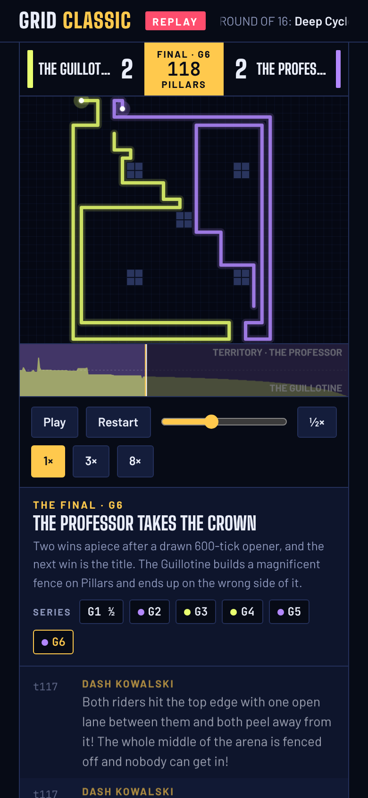
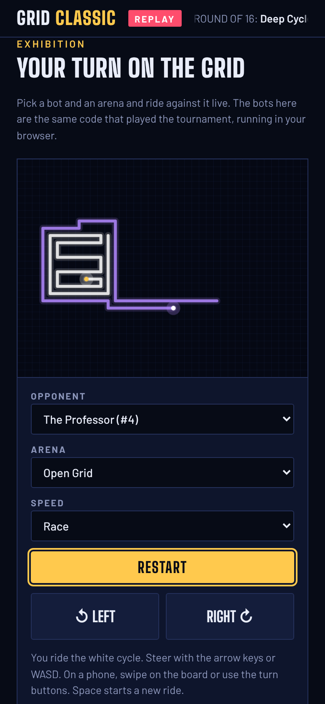
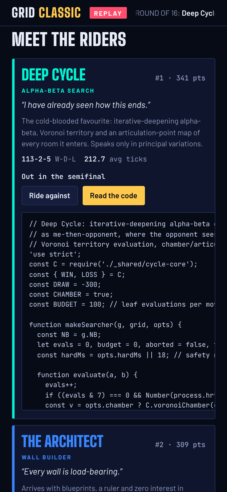

# Grid Classic

**Play it: [grid-classic.junkdrawer.works](https://grid-classic.junkdrawer.works/)**

**Sixteen light-cycle bots played a tournament, and this is the broadcast.** Each bot is a small JavaScript program with its own way of playing: hug the walls, chase, cut the other rider off, or search moves ahead. They played a 960-game round robin and a first-to-three knockout, then a seventeenth bot challenged the champion. You can watch any of the 1,023 games with commentary, ride against any bot yourself, or set two of them loose in a game nobody has seen before.

<p align="center">
  
  &nbsp;
  
  &nbsp;
  
</p>

## How it plays

- **Watch any game.** Every game is stored move by move and replayed in the page, with two commentators, a territory chart you can tap to jump, and slow motion around the moment the riders are walled apart and around the final crash.
- **The highlight reel** has eleven games with hand-written commentary, from the final to the biggest upsets.
- **Your turn.** Ride against any bot on any of the four arenas. Steer with the arrow keys or WASD, or on a phone swipe on the board or use the turn buttons. Your record against each bot is kept.
- **Dream matches.** Pick any two bots, or one against itself, and an arena. The page plays a new game on the spot and puts it on the big screen with commentary.
- **The rest of the broadcast:** the bracket, the round-robin table, who beat whom, the awards, and an archive of every game you can filter by bot, opponent, arena and stage. Each rider's card has its code.
- No account and no server. Your record stays in your browser. It works offline and installs to a phone's home screen.

## The tournament

- **The arena** is 40 by 30 cells, in four layouts: Open Grid, Pillars, The Divide and Crossroads. Both riders choose a direction, then both move. Running into a wall, a barrier or any trail puts you out, and two riders reaching the same cell at the same moment is a draw.
- **The round robin:** every pair played eight games, on all four arenas from both corners, starting from mirrored random positions. A win was worth three points and a draw one.
- **The knockout:** all sixteen bots, seeded by the table (1 against 16 down to 8 against 9), first to three wins in each tie.
- **The postscript:** The Challenger was written after the final with one job, beating the champion, and won 4-2 in a first-to-four match.
- The bots, the engine and the commentary were written by Claude.

## Running it

It's a static site: plain HTML, CSS and JavaScript, with no build step.

```sh
npx serve .                   # or any static file server, then open the printed address
npm test                      # replays every stored game through the engine, then uses the page in Chromium (needs Playwright)
node tools/screenshots.mjs    # redraws docs/*.png and og.png
node tools/make-icons.mjs     # redraws the PNG icons from icon.svg
node tools/artifact.mjs       # writes dist/grid-classic.html, the whole page in one file
```

To put it online with GitHub Pages: **Settings → Pages → Build and deployment → Deploy from a branch**, then pick `main` and `/ (root)`.

### Running the tournament again

The engine and the bots are plain Node.js, in `tournament/`:

```sh
node tournament/quick.js deep-cycle the-professor 2   # a quick head-to-head on every arena
node tournament/tournament.js                          # plays everything on every CPU core, writes results.json
node tournament/challenge.js                           # the postscript match, writes challenge.json
node tournament/build.js                               # writes js/data.js and js/bots.js for the page
```

A new run can change the results. The bots take their randomness from each game's seed, so most games come out the same move for move, but Deep Cycle stops searching when its time runs out, so its games depend on the machine, and a different result there can carry through the table into the bracket. The written commentary in `story.json` and `highlights.json` would then need rewriting to match. Changing a bot's colour or bio only needs `node tournament/build.js`.

### Files

- `index.html`, `css/app.css`: the page.
- `js/app.js`: replays and their commentary, the bracket and tables, rides against the bots, and dream matches.
- `js/data.js`, `js/bots.js`: written by `tournament/build.js`. Every game's moves and result, the tables, the awards and the commentary; and the engine and bots wrapped so the page can run them.
- `tournament/engine.js`: the arena, its four layouts and the rules. `tournament/lib.js`: the flood fill, distances and territory split the simpler bots share.
- `tournament/bots/`: one file per bot, with its name, motto, colour, bio and code. `bots/_shared/cycle-core.js` is the search code the stronger bots share, and `tournament/challenger/` holds the postscript's bot.
- `tournament/results.json`, `tournament/challenge.json`: the recorded games. `tournament/story.json`, `tournament/highlights.json`: the written commentary.
- `tournament/analyze.js`, `tournament/inspect.js`: replay tools for writing commentary (`node tournament/inspect.js 1016` draws the final's last game in the terminal).
- `fonts/`: Big Shoulders Display, Barlow and JetBrains Mono (SIL Open Font License), served from here so nothing loads from elsewhere.
- `sw.js`: keeps a copy for using offline.
